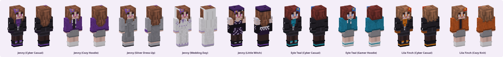
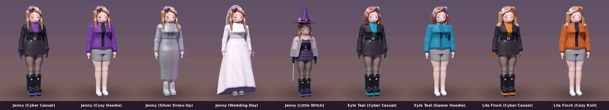
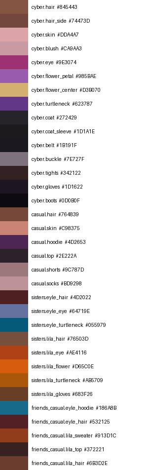

# 제니 캐릭터 바이블 (Character Bible)

> Project Haven — Jenny In Usual 의 콘셉트·비주얼·성격 기준 문서.
> 새 스킨, 2차 창작, 레시피를 만들 때 이 문서를 기준으로 판단합니다.

## 1. 정체성

- **누구인가:** 친구들과 방에서 피자를 먹고, 게임을 하고, 수다를 떠는 평범하고 독립적인 사람.
  누군가의 소비 대상이나 도구가 아니라 스스로의 일상을 가진 주체입니다.
- **핵심 가치:** 가상과 현실 모두에서의 *인간 존중*. 캐릭터를 아끼는 방식으로 캐릭터를 다룹니다.
- **분위기:** 아늑함, 장난기 있는 미소, 친구와 함께 있는 편안함.

## 2. 비주얼 가이드

### 시그니처 룩

| 룩 | 레퍼런스 | 구성 | 스킨 |
|---|---|---|---|
| 사이버 캐주얼 | `03_Sources/3D_Models/JennyCartoon3D.jpg` | 보라 터틀넥, 검은 롱코트(은색 버클 벨트·소매 스트랩), 어두운 타이츠, 보라 포인트 워커 부츠, 보라 꽃핀 | `Jenny_Cyber_Skin.png` |
| 아늑한 후드티 | `03_Sources/3D_Models/JennyInUsual.jpg` | 보라 집업 후드티, 검은 이너, 회색 라운지 반바지, 흰 양말 | `Jenny_Casual_Skin.png` |
| 실버 드레스업 | `03_Sources/3D_Models/JennyDressUp.png` | 실버 크롭 재킷, 회색 니트 미디 드레스, 보라 클러치, 실버 앵클부츠 | `Jenny_DressUp_Skin.png` |
| 웨딩 데이 | `03_Sources/3D_Models/JennyMarriage.png` | 라벤더 자수 웨딩드레스, 베일, 실버 부츠 | `Jenny_Wedding_Skin.png` |
| 리틀 위치 | `03_Sources/3D_Models/JennyLovesWitchCraft.png` | 보라 마녀 모자(꽃핀), 은빛 다마스크 드레스, 코르셋 벨트, 초커, 비치는 레이스 망토, 긴 장갑, 워커 부츠, 지팡이 | `Jenny_Witch_Skin.png` |

### 제니의 두 친구

| 캐릭터 | 레퍼런스 | 얼굴·머리 | 룩 | 스킨 |
|---|---|---|---|---|
| **에일 틸 (Eyle Teal)** | `JennySisters.png` 왼쪽 · `JennyInUsual.jpg` 왼쪽 | 적갈색 턱선 단발, 푸른 눈, 오른쪽 파란 꽃핀 | 틸 터틀넥 코트 세트 / 청록 후드티 + 줄무늬 양말 | `Eyle_Teal_Cyber_Skin.png`, `Eyle_Teal_Casual_Skin.png` |
| **릴라 핀치 (Lila Finch)** | `JennySisters.png` 오른쪽 · `JennyInUsual.jpg` 오른쪽 | 밝은 갈색 어깨 길이 웨이브, 앰버 눈, 오른쪽 붉은 꽃핀 | 앰버 터틀넥 코트 세트(주황 장갑) / 오렌지 니트 가디건 | `Lila_Finch_Cyber_Skin.png`, `Lila_Finch_Casual_Skin.png` |

### 곡선 3D 메이크업 설계

캐릭터의 본 설계는 곡선 3D 입니다 (`DollyForge/core/src/sculpt.c`). 체형은 레퍼런스 실측값으로 고정하고,
메이크업은 얼굴 위의 곡선(눈매·속눈썹 윙·홍채·눈썹 아치·홍조·입술)과 머릿결 윤기로 설계합니다.
64×64 스킨은 같은 팔레트로 만든 바닐라 게임용 번역본입니다.

### 레퍼런스를 옮기는 원칙 — 바꾸지 않고 그대로

3D 레퍼런스의 곡선미와 아름다움은 이 캐릭터들의 본모습입니다. 스킨은 그것을 **바꾸지 않고** 마인크래프트 규격 안으로 옮깁니다.
마인크래프트 모델의 형태(박스)는 고정이므로, 곡선은 빛과 그림자로 옮깁니다.

| 레퍼런스 | 스킨에서 옮긴 방법 |
|---|---|
| 큰 아몬드형 눈, 진한 위 속눈썹, 흰자, 아래가 밝은 홍채 | 속눈썹 1줄 + 흰자·홍채 2줄의 큰 눈, 홍채 위 진하게·아래 밝게 |
| 머리색 계열의 가는 눈썹, 볼의 홍조, 살짝 올라간 미소 | 눈썹 `hair*0.78`, 볼 블러시, 2px 미소 |
| 윤기 있는 머리 | 정수리·옆머리를 두르는 윤기 띠 `hair*1.32` |
| 꽃핀의 크기와 위치 (제니는 왼쪽, 에일·릴라는 오른쪽) | 앞면 3×2 + 윗면 + 옆면으로 감싸는 꽃 |
| 벨트로 조인 허리 | 허리 양옆과 옆면의 그림자, 허리로 모이는 코트 여밈선 |
| 골반에서 퍼지는 코트·드레스 자락 | overlay 층이 골반 높이부터 바깥으로 떠서 퍼짐 |
| 허벅지 앞-바깥을 따라 흐르는 타이츠 광택 | 다리마다 끊기지 않는 광택 한 줄 + 안쪽 그늘 |
| 둥근 팔 | 몸 쪽 안면 그늘 |

### 팔레트

`reference_palette.json` 은 레퍼런스 렌더의 지정 영역에서 중앙값으로 뽑은 색입니다
(`DollyForge/python/tools/extract_palette.py`, 영역 정의는 `DollyForge/characters/jenny/reference_probes.json`).
렌더 조명이 들어간 값이라 게임 안에서는 어둡게 뜨므로, 스킨 팔레트는 이 값을 출발점으로 명도를 올려 정했습니다.

| 역할 | 레퍼런스 추출값 | 스킨 팔레트 |
|---|---|---|
| 머리 | `#845443` | `#8E5A44` (그림자 `hair*0.79`, 하이라이트 `hair*1.18`) |
| 피부 | `#DDA4A7` (볼, 블러시 포함) | `#F2C4B0` |
| 눈 | `#9E3074` | `#A8317E` / `#D460AE` |
| 꽃핀 꽃잎 · 꽃술 | `#985BAE` · `#D3B070` | `#A066C4` · `#EBC35C` |
| 터틀넥 | `#623787` | `#6E3B98` |
| 코트 | `#272429` | `#2B272F` |
| 타이츠 | `#342122` | `#3D2A2B` |
| 후드티 | `#4D2653` (따뜻한 조명) | `#6C3794` |

### 해야 할 것 / 하지 않을 것

| ✅ 이렇게 | ❌ 이렇게 하지 않음 |
|---|---|
| 일상복, 계절감 있는 옷, 직업·취미 의상 | 노출을 목적으로 한 의상, 속옷·수영복을 주제로 한 스킨 |
| 표정은 웃음·장난·집중 등 일상의 감정 | 성적 뉘앙스의 표정·포즈·연출 |
| 친구와 함께하는 장면, 방·카페·공원 | 캐릭터를 도구나 보상처럼 다루는 장면 |
| 레퍼런스 3D 모델의 체형과 곡선미를 그대로 옮김 (slim 모델 + 음영) | 레퍼런스의 체형을 바꾸는 편집 — 부풀리지도, 깎아내지도 않는다 |
| 보라색 계열 + 꽃핀을 시그니처로 유지 | 시그니처 없이 이름만 빌린 다른 캐릭터 |

## 3. 성격과 세계관

- 밝고 장난기 많지만 친구의 이야기를 끝까지 들어 주는 편.
- 게임을 좋아하고 지면 바로 "한 판 더"를 외친다. 피자는 페퍼로니.
- 방에는 토끼 모티프 소품, 사진, 식물, 따뜻한 조명 — *Good Food, Good Friends, Happy Days*.
- **에일 틸**, **릴라 핀치**와는 같은 코트를 색만 바꿔 맞춰 입을 만큼 자매처럼 지낸다.
  - 에일: 게임 패드를 쥐면 윙크부터 하는 승부사. 청록이 상징색. (초안)
  - 릴라: 피자 한 조각에 세상 행복한 미식가, 셋 중 가장 당당한 포즈. 앰버가 상징색. (초안)

## 4. 새 스킨을 만들 때

1. 위 가이드에 맞는 룩을 정하고 레퍼런스 이미지를 `03_Sources/3D_Models/` 에 둔다.
2. `DollyForge/characters/<캐릭터>/` 에 레시피를 만든다. 얼굴·머리 base 와 의상을 함께 물려받으려면 `"extends": ["<캐릭터>_base.dolly.json", "../jenny/jenny_cyber.dolly.json"]`.
3. `meta.rating` 은 반드시 `all-ages`, `meta.license` 는 `CC-BY-NC-ND-4.0` — `dolly-guard lint` 가 확인한다.
4. `python3 DollyForge/build.py` 로 스킨·미리보기·배포 팩을 갱신한다.
