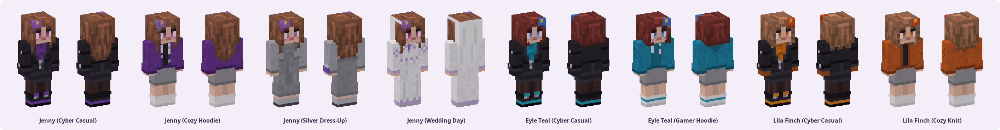

# 스킨 적용 가이드



| 스킨 | 파일 | 팔 모델 |
|---|---|---|
| 제니 (사이버 캐주얼) | `03_Sources/Minecraft_Skins/Jenny_Cyber_Skin.png` | 슬림 (Alex) |
| 제니 (아늑한 후드티) | `03_Sources/Minecraft_Skins/Jenny_Casual_Skin.png` | 슬림 (Alex) |
| 제니 (실버 드레스업) | `03_Sources/Minecraft_Skins/Jenny_DressUp_Skin.png` | 슬림 (Alex) |
| 제니 (웨딩 데이) | `03_Sources/Minecraft_Skins/Jenny_Wedding_Skin.png` | 슬림 (Alex) |
| 에일 틸 (사이버 캐주얼) | `03_Sources/Minecraft_Skins/Eyle_Teal_Cyber_Skin.png` | 슬림 (Alex) |
| 에일 틸 (게이머 후드티) | `03_Sources/Minecraft_Skins/Eyle_Teal_Casual_Skin.png` | 슬림 (Alex) |
| 릴라 핀치 (사이버 캐주얼) | `03_Sources/Minecraft_Skins/Lila_Finch_Cyber_Skin.png` | 슬림 (Alex) |
| 릴라 핀치 (아늑한 니트) | `03_Sources/Minecraft_Skins/Lila_Finch_Casual_Skin.png` | 슬림 (Alex) |

모든 스킨은 **슬림(3px 팔)** 모델용입니다. 클래식(Steve)으로 적용하면 팔 옆에 빈 줄이 생깁니다.

## Java Edition

1. <https://www.minecraft.net> 에 로그인 → 프로필 → **스킨(Skin)**.
   또는 Minecraft 런처 → **Minecraft: Java Edition** → **스킨(Skins)** → **새 스킨(New skin)**.
2. 팔 모델을 **슬림(Slim)** 으로 선택.
3. 위 PNG 파일을 올리고 저장. 게임을 다시 시작하면 적용됩니다.

## Bedrock Edition (Windows · 모바일 · 콘솔)

**방법 A — 스킨 하나 적용 (가장 확실함)**
1. 게임 → **드레싱 룸(Dressing Room)** → **클래식 스킨** → **보유(Owned)** 의 빈 칸 → **새 스킨 선택(Choose New Skin)**.
2. PNG 를 고르고 팔 모델을 **슬림(얇은 팔)** 으로 선택.

**방법 B — 스킨팩 가져오기**
1. `05_Distribution/bedrock/JennyInUsual.mcpack` 을 실행(더블클릭)하면 Minecraft 가 가져오기를 시작합니다.
2. 드레싱 룸에서 "제니의 평범한 하루" 팩을 찾습니다.
   버전과 플랫폼에 따라 직접 가져온 스킨팩이 목록에 보이지 않을 수 있습니다 — 그때는 방법 A 를 쓰세요.

## 파일이 공식본인지 확인하기

```bash
DollyForge/rust/dolly-guard/target/release/dolly-guard verify --manifest 05_Distribution/integrity.json 받은스킨.png
```

`OFFICIAL` 이 아니면 변형본입니다. 어느 부위가 몇 픽셀 바뀌었는지도 함께 표시됩니다.
