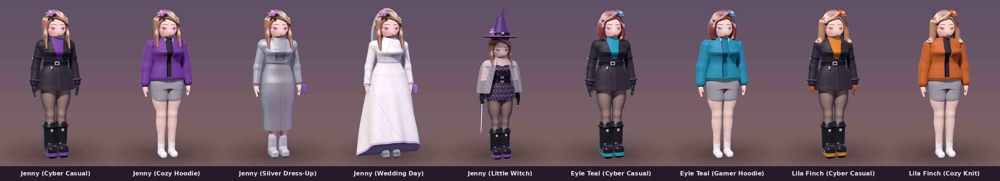

# Dolly Forge

마인크래프트 캐릭터를 **메이크업(색·얼굴·의상)하고 개발(레시피 → 스킨 → 배포 팩)** 하는 툴킷입니다.
Project Haven — Jenny In Usual 의 모든 스킨은 이 도구로 만들어집니다.


## 구조 — C 코어 하나를 여섯 언어가 공유

마인크래프트 자체가 Java(Java Edition) · C++(Bedrock) · Python(모딩/도구 생태계) 으로 나뉘어 있듯이,
Dolly Forge 도 각 언어가 맡는 자리가 있습니다. 단, **스킨 규격·레시피 해석·PNG·검증은 전부 C 코어 한 곳**에서
처리하므로 어떤 도구로 만들어도 결과가 픽셀 단위로 같습니다.

```
                      ┌─────────────────────────────┐
                      │  C   core/  libdollyforge    │  64x64 UV 레이아웃 · PNG 코덱(inflate 포함)
                      │      (C99, 의존성 없음)       │  · JSON · 레시피 실행 · 검증 · diff
                      └──────────────┬──────────────┘
        ┌──────────────┬─────────────┼──────────────┬────────────────┐
   static link     static link     ctypes        P/Invoke       같은 규격(64x64)
        │              │             │              │                │
 C++  cpp/        Rust rust/    Python python/  C#  csharp/     Java java/
 dolly-forge CLI  dolly-guard   바인딩·팔레트    Dolly Forge     DollyPreview
 + Bedrock        서명·검증·     추출·빌드        Studio (GUI)    3D 렌더러
 .mcpack 패키저   라이선스 린트   파이프라인       메이크업 편집기  (Java Edition 모델)
```

| 언어 | 위치 | 하는 일 |
|---|---|---|
| **C** | `core/` | `libdollyforge` — **곡선 3D 엔진**(SDF 몸·의상·머리 + 곡선 메이크업 + 레이마칭 렌더), 스킨 UV 표, PNG 코덱, JSON 파서, 레시피 엔진, 검증기, 픽셀 diff |
| **C++** | `cpp/` | `dolly-forge` CLI (`forge` `validate` `info` `diff` `preview` `pack-bedrock`), Bedrock 스킨팩 ZIP 작성기 |
| **Java** | `java/` | `DollyPreview` — Java Edition 플레이어 모델(classic/slim, 2중 레이어) 정사영 3D 렌더, 라인업 이미지 |
| **Python** | `python/` | `dollyforge` ctypes 바인딩, `recipe` 포매터, 레퍼런스 팔레트 추출, 회귀 테스트, `build.py` |
| **C#** | `csharp/` | **Dolly Forge Studio** (Avalonia) — 곡선 3D 실시간 미리보기, 메이크업 곡선 슬라이더, 팔레트 편집, 변형 레시피 저장 |
| **Rust** | `rust/` | `dolly-guard` — 공식 스킨 SHA-256 서명, 무단 변형 감지(어느 파트가 몇 px 바뀌었는지), 레시피 메타/라이선스 린트 |

## 곡선 3D — 레퍼런스의 곡선미를 그대로



`03_Sources/3D_Models` 의 캐릭터는 매끈한 곡면으로 된 3D 인물입니다. Dolly Forge 는 그것을 픽셀로 줄이지 않고
**부호 거리장(SDF) 곡면**으로 다시 세웁니다 (`core/src/sculpt.c`).

- **체형**: `JennyCartoon3D.jpg` 실루엣을 키 1.6m 로 환산해 랜드마크(어깨 1.23m · 가슴 1.16m · 허리 1.037m ·
  골반 0.91m · 허벅지 0.67m · 무릎 0.47m · 종아리 0.40m)마다 단면을 재고, Catmull-Rom 으로 이어 몸통을 만든다.
  팔다리·머리·얼굴은 smooth-union 으로 이음매 없이 붙는다. 체형 값은 레퍼런스 그대로 고정 (`figure` 는 모두 1).
- **메이크업 = 얼굴 위의 곡선**: 아몬드형 눈매(위·아래 눈꺼풀 곡선, 눈꼬리 기울기), 진한 위 속눈썹과 윙,
  위는 진하고 아래는 밝은 홍채 + 큰 하이라이트, 쌍꺼풀 선, 바깥으로 가늘어지는 눈썹 아치, 볼 홍조, 미소 곡선,
  머릿결 윤기 띠. 모두 `doll.makeup` 값으로 조절한다.
- **의상**: 코트(가슴에서 열리고 벨트에서 닫힘, 골반에서 퍼지는 자락) · 후드티 · 메탈릭 미디 드레스 ·
  하이로우 웨딩드레스와 비치는 베일 · 마녀 룩(모자·다마스크 드레스·레이스 망토·장갑·지팡이). 색은 스킨과 **같은 팔레트**.
- **질감**: 머리카락 가닥 홈 + Kajiya-Kay 띠 하이라이트, 피부 속 산란, 다섯 손가락, 금속의 환경 반사,
  레이스·자수·다마스크 무늬.
- **머리**: 긴 생머리(제니) · 턱선 단발(에일 틸) · 어깨 웨이브(릴라 핀치), 가르마에서 쓸어 넘긴 앞머리, 꽃핀 위치.

```jsonc
"doll": {
  "hair":   { "style": "long" },          // long | bob | wavy
  "flower": { "side": "right" },          // 캐릭터 기준
  "outfit": { "type": "cyber" },          // cyber | casual | dressup | wedding | witch
  "figure": { "bust": 1, "waist": 1, "hips": 1, "thighs": 1 },   // 1 = 레퍼런스 실측 (바꾸지 않는다)
  "makeup": { "eye_size": 1, "eye_open": 0.66, "eye_tilt": 0.35, "lash": 1,
              "brow_arch": 1, "blush": 0.75, "lip_curve": 1, "gloss": 1 }
}
```

```bash
DollyForge/build/dolly-forge sculpt DollyForge/characters/jenny/jenny_cyber.dolly.json -o jenny.png --size 800x1200 --hq
DollyForge/build/dolly-forge sculpt ... --zoom 4 --yaw 8      # 얼굴 클로즈업
```

마인크래프트 바닐라 스킨은 박스 모델이라 곡면을 담을 수 없습니다. 그래서 같은 레시피가 세 가지를 함께 만듭니다.

| 결과 | 명령 | 용도 |
|---|---|---|
| 곡선 3D 렌더 | `dolly-forge sculpt` | 설계·홍보 이미지 |
| 곡선 3D 메시 (OBJ + MTL + 팔레트 PNG) | `dolly-forge export-3d --obj` | Blender · Blockbench |
| Figura 아바타 (`.bbmodel` 메시 + `script.lua`) | `dolly-forge export-3d --figura` | 게임 안 곡선 모델 (Java Edition + Figura 모드) |
| 64×64 스킨 | `dolly-forge forge` | 바닐라 게임 |

메시는 SDF 를 격자로 샘플링해 Surface Nets 로 뽑고, 정점을 곡면 위로 한 번 끌어당긴 뒤, 메이크업·무늬가 들어간 표면색을
256×256 팔레트 텍스처(R6·G6·B4)로 굽습니다. Figura 용은 바닐라 애니메이션을 따르도록 삼각형을 머리·몸·팔·다리 그룹으로 나눕니다.

## 빌드

필요한 것: CMake 3.16+, C/C++ 컴파일러, JDK 17+, Python 3.10+ (Pillow), Rust (cargo), .NET 10 SDK.
모두 인터넷 없이 빌드됩니다 (Rust 는 외부 crate 없음, C# 는 Avalonia 11.3.22 NuGet 캐시 필요).

```bash
python3 DollyForge/build.py          # 전체: 테스트 → 스킨 → 서명 → 미리보기 → .mcpack → Studio
python3 DollyForge/build.py --no-studio
```

`build.py` 가 만드는 것:

| 결과물 | 위치 |
|---|---|
| 게임 적용 규격 스킨 PNG (64×64, slim) | `03_Sources/Minecraft_Skins/Jenny_*_Skin.png` |
| 레퍼런스 렌더에서 뽑은 팔레트 | `01_Concepts/reference_palette.json/.png` |
| 곡선 3D 렌더 (전신·얼굴) · 3D 라인업 | `05_Distribution/previews/3D/`, `previews/Lineup_3D.png` |
| 스킨 3D 미리보기 · 라인업 · Studio 스크린샷 | `05_Distribution/previews/` |
| Bedrock 스킨팩 | `05_Distribution/bedrock/JennyInUsual.mcpack` |
| 무결성 서명 | `05_Distribution/integrity.json` |

## 도구 사용법

```bash
B=DollyForge/build
$B/dolly-forge forge DollyForge/characters/jenny/jenny_cyber.dolly.json -o out.png --preview flat.png
$B/dolly-forge validate some_skin.png          # 64x64? base 레이어에 구멍? 레이아웃 밖 픽셀?
$B/dolly-forge diff official.png suspicious.png

G=DollyForge/rust/dolly-guard/target/release/dolly-guard
$G verify --manifest 05_Distribution/integrity.json suspicious.png
#  → OFFICIAL / MODIFIED — derived from Jenny_Cyber_Skin.png with 2 pixel(s) changed (head 1px, body 1px) / UNKNOWN

java -cp $B/java dollyforge.DollyPreview render skin.png preview.png --scale 12

dotnet DollyForge/csharp/DollyForge.Studio/bin/Release/net10.0/dolly-forge-studio.dll   # GUI
```

Python 에서:

```python
import sys; sys.path.insert(0, "DollyForge/python")
import dollyforge as df
skin = df.forge("DollyForge/characters/jenny/jenny_cyber.dolly.json")
print(skin.slim, skin.validate())          # True (0, [])
```

## 레시피 형식 (`*.dolly.json`)

스킨을 PNG 로 직접 그리는 대신 **레시피**로 기술합니다. 레시피는 사람이 읽고 리뷰할 수 있고(diff 가 의미 있음),
팔레트만 바꾼 "메이크업 변형"을 몇 줄로 만들 수 있습니다.

```jsonc
{
  "dollyforge": 1,
  "meta": { "id": "jenny_cyber", "title": { "en_US": "...", "ko_KR": "..." },
            "author": "...", "license": "CC-BY-NC-ND-4.0", "rating": "all-ages" },
  "extends": ["eyle_teal_base.dolly.json",  // 캐릭터의 얼굴·머리
              "../jenny/jenny_cyber.dolly.json"],  // + 의상 (파일 하나만 써도 됨)
  "model": "slim",                         // slim(3px 팔) | classic(4px 팔)
  "palette": {
    "// reference": "주석 키는 // 로 시작",
    "turtleneck": "#6E3B98",
    "turtleneck_dark": "turtleneck*0.8"    // 파생색: 원색을 바꾸면 따라 바뀜
  },
  "legend": { "T": "turtleneck", "t": "turtleneck_dark" },
  "ops": [
    { "op": "fill",   "part": "body", "faces": "all", "color": "coat" },
    { "op": "band",   "part": "body", "y": 7, "h": 1, "color": "belt" },
    { "op": "pixels", "part": "body", "face": "front", "rows": ["CCTTTTCC", "..."] },
    { "op": "mirror", "from": "arm_r", "to": "arm_l" }
  ]
}
```

| 항목 | 값 |
|---|---|
| `part` | `head` `body` `arm_r` `arm_l` `leg_r` `leg_l`, 묶음 `arms` `legs` `*`, 또는 배열 |
| `face(s)` | `top` `bottom` `right` `front` `left` `back`, 묶음 `sides` `all` |
| `layer` | `base` (기본, 반드시 불투명) · `overlay` (모자·재킷·소매·바지 2층) |
| 색 | `#RGB` `#RRGGBB` `#RRGGBBAA`, 팔레트 키, `clear`, `키*배율` |
| `fill` | 면 전체 칠하기 |
| `rect` | 면 안 사각형 (`x y w h`, 면 기준 좌표) |
| `band` | 측면 4개를 두르는 띠 (`y h`) — 벨트, 소맷부리, 부츠 |
| `pixels` | 픽셀 아트 (`rows` + `legend`, `.` 은 건너뜀, `flip` 으로 좌우 반전) |
| `mirror` | 팔/다리 한쪽을 반대쪽으로 좌우 반전 복사 (두 레이어 모두) |
| `shade` | 결정적 노이즈로 명도를 살짝 흔들어 천·머리결 표현 (`amount`, `seed`, `only`) |
| `note` | 주석 |

면 좌표는 그 면을 바깥에서 바라봤을 때 왼쪽 위가 (0,0) 입니다. `extends` 는 파일 하나 또는 배열이며,
부모들이 적힌 순서대로 먼저 실행되고(공통 조상은 한 번만), `palette`/`legend` 는 뒤에 오는 쪽이 덮어씁니다.
그래서 "캐릭터 얼굴 + 다른 캐릭터의 의상 + 색만 바꾼 자식" 이 몇 줄로 됩니다
(예: `characters/eyle_teal/eyle_teal_cyber.dolly.json`).

## 캐릭터 추가하기

1. `characters/<이름>/` 에 레시피를 만든다 (얼굴·머리는 `<이름>_base.dolly.json` 으로 분리, `"meta": {"abstract": true}`; 의상은 기존 레시피를 배열 `extends` 로 재사용).
2. Studio 에서 색을 다듬고 "변형 레시피 저장", 또는 레시피를 직접 편집한다.
3. `characters/jenny/collection.json` 에 넣고 (경로는 그 파일 기준) `python3 DollyForge/build.py`.
4. `dolly-guard lint` 가 메타·라이선스·연령 등급·게임 규격을 모두 통과해야 배포 팩에 들어간다.

## 명칭·공식성에 대해

- Dolly Forge 는 Mojang/Microsoft 의 공식 도구가 아니며, 마인크래프트 브랜드 가이드라인에 따라 공식처럼 보이게
  표기하지 않습니다. "공식"이 될 수 있는 범위는 **Project Haven 이 공식으로 쓰는 제작 도구**까지입니다.
  마인크래프트 안에서의 공식 유통은 Minecraft Marketplace 파트너 프로그램을 거쳐야 합니다.
- "Forge" 는 널리 쓰이는 모드 로더 *Minecraft Forge* 와 이름이 겹칩니다. 외부 공개 시 혼동이 없도록 설명을 붙이거나
  이름을 검토하는 것이 좋습니다.
- 이 폴더의 **코드** 라이선스는 아직 정하지 않았습니다. 스킨 에셋의 CC BY-NC-ND 4.0 은 코드에 맞지 않으므로
  (Creative Commons 도 소프트웨어에는 권장하지 않음) 코드는 별도 라이선스를 정해야 합니다.

NOT AN OFFICIAL MINECRAFT PRODUCT. NOT APPROVED BY OR ASSOCIATED WITH MOJANG OR MICROSOFT.
