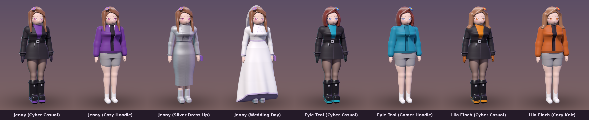
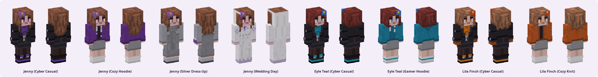

# Project_Haven_Jenny_In_Usual

본 프로젝트는 비공식 성인용 모드(Mod)로 인해 왜곡되고 대상화되었던 캐릭터를 본래의 평범하고 건강한 일상 속으로 되돌려놓고, 전 세계 마인크래프트 유저들이 떳떳하게 사용할 수 있는 양지의 정식 캐릭터 및 스킨으로 재창조(Recreation)하는 개발 프로젝트입니다.

---

## 📂 프로젝트 폴더 구조 및 작업 내용

### 📄 01_Concepts (콘셉트 및 세계관 기획)
- **핵심 작업:** 캐릭터의 일상화 콘셉트 기획 및 정체성 가이드라인 확립
- **상세 기획 내용:**
  - **비주얼 가이드:** 자극적이고 과도한 성적 대상화 설정을 전면 배제합니다. 친근하고 아늑한 '보라색 후드티' 및 세련되면서도 건전한 'SF/사이버펑크 스타일 일상복'을 핵심 아이덴티티로 삼습니다.
  - **세계관 및 캐릭터 성격:** 소비의 대상이나 도구가 아닌, 친구들과 방에서 피자를 먹고 게임을 즐기며 대화하는 평범하고 독립적인 인격을 가진 주체로 캐릭터를 묘사합니다. 가상과 현실 전반에 걸쳐 '인간 존중'의 가치를 확산시키는 것을 목표로 합니다.
- **파일:**
  - `Character_Bible.md` : 정체성, 시그니처 룩, 팔레트, 해야 할 것 / 하지 않을 것, 성격과 세계관
  - `reference_palette.json` / `.png` : 3D 레퍼런스 렌더에서 영역별로 추출한 실제 색 (Dolly Forge 가 생성)

### 🖼️ 02_Synthetics (2차 창작 이미지)
- **핵심 작업:** 평범하고 따뜻한 일상을 담은 그래픽 작업물 축적 및 아카이빙
- **상세 내용:**
  - 캐릭터를 향한 애정과 존중을 바탕으로 제작된 힐링 감성의 일상 합성본들을 안전하게 관리합니다.
  - `README.md` : 수록 기준, 파일 이름 규칙, 출처 기록 양식

### 🎨 03_Sources (인게임 리소스 및 3D 모델)
- **핵심 작업:** 인게임 등록 및 연출을 위한 규격 리소스 확보 (🌟 게임 적용 규격 스킨 제작 완료)
- **Minecraft_Skins:** (64×64 PNG, 슬림 모델 — Dolly Forge 레시피로 생성, 게임 규격 검증 통과)
  - `Jenny_Cyber_Skin.png` : SF/사이버펑크 스타일(보라색 이너, 검은색 코트, 워커 부츠, 꽃 머리 장식)을 마인크래프트 고유의 각진 블록 텍스처 스타일로 이식한 실제 게임 적용 규격의 원본 스킨 파일입니다.
  - `Jenny_Casual_Skin.png` : 보라색 집업 후드티와 회색 라운지 반바지 차림의 아늑한 방 안 일상복 스킨입니다.
  - `Jenny_DressUp_Skin.png` : 실버 크롭 재킷과 니트 미디 드레스, 보라 클러치를 매치한 외출복 스킨입니다.
  - `Jenny_Wedding_Skin.png` : 라벤더 자수 웨딩드레스와 베일 차림의 스킨입니다.
  - `Eyle_Teal_Cyber_Skin.png` / `Eyle_Teal_Casual_Skin.png` : **에일 틸** — 적갈색 단발에 푸른 눈, 틸 코트 세트와 청록 후드티.
  - `Lila_Finch_Cyber_Skin.png` / `Lila_Finch_Casual_Skin.png` : **릴라 핀치** — 밝은 갈색 웨이브에 앰버 눈, 앰버 코트 세트와 오렌지 니트.
  - 모든 스킨은 3D 레퍼런스의 곡선미(조인 허리, 퍼지는 골반 라인, 다리 광택)와 얼굴(큰 눈, 속눈썹, 홍조, 머릿결 윤기)을 바꾸지 않고 음영으로 옮겼습니다.
  - `JennyOriginal.jpeg` : 블록 스타일 렌더 레퍼런스 이미지 (스킨 텍스처 파일이 아님)
- **3D_Models:**
  - `JennyInUsual.jpg` : 침실 안에서 친구들(왼쪽 에일 틸, 오른쪽 릴라 핀치)과 함께 피자를 먹고 게임 패드를 든 채 환하게 웃고 있는 아늑한 일상 장면의 3D 연출 이미지입니다.
  - `JennyCartoon3D.jpg` : 보라색 톤의 이너와 검은색 코트, 워커 부츠 및 머리 장식을 매치한 SF/사이버펑크 풍의 세련된 독립 캐릭터 3D 모델 전신 이미지입니다.
  - `JennySisters.png` : 같은 코트 세트를 각자의 색으로 맞춰 입은 에일 틸(틸) · 제니(보라) · 릴라 핀치(앰버)의 3D 이미지입니다.
  - `JennyDressUp.png` : 실버 재킷과 미디 드레스 차림의 외출 룩 3D 이미지입니다.
  - `JennyMarriage.png` : 라벤더 자수 웨딩드레스와 베일 차림의 3D 이미지입니다.

### 📚 04_References (법적·도의적 레퍼런스)
- **핵심 작업:** 올바른 창작 문화를 위한 법적 보호 근거 및 인권 보호 자료 수집
- **상세 내용:**
  - 베른 협약에 기초한 국제 저작권법 보호 사례 및 글로벌 플랫폼의 DMCA 테이크다운 가이드라인을 정리합니다.
  - 현실 세계의 성매매 종사자 및 디지털 성범죄 피해자들이 겪는 인권 침해와 방치 문제에 대응하고 인간적인 존중을 지키기 위한 사회적 메시지 자료를 보관합니다.
  - `Legal_and_Ethics.md` : 권리 범위, 베른 협약·저작권법(동일성유지권), CC BY-NC-ND, 무단 변형물 대응 절차(DMCA 통지 요건), 마인크래프트 브랜드 가이드라인, 도움 기관 연락처

### 📦 05_Distribution (패키징 및 라이선스 가이드)
- **핵심 작업:** 최종 마인크래프트 등록용 패키징 및 무단 변형 방지를 위한 라이선스 적용
- **배포 패키지 구조:**
  - `Install_Guide.md` : 마인크래프트 자바 에디션 / 베드락 에디션 적용 가이드
  - `bedrock/JennyInUsual.mcpack` : 베드락 에디션용 스킨팩 (스킨 8종, 영어·한국어 이름)
  - `integrity.json` : 공식 스킨의 SHA-256 서명 — 무단 변형본 판별용
  - `previews/` : 곡선 3D 렌더(`3D/`, `Lineup_3D.png`), 스킨 미리보기, 라인업, Dolly Forge Studio 화면
- **라이선스 가이드 (CCL 조건 적용):** `LICENSE.md`
  - 본 프로젝트를 통해 재창조된 스킨 및 캐릭터 에셋은 **CC BY-NC-ND (저작자표시-비영리-변경금지)** 조건을 따릅니다.
  - **조건 1 (비영리):** 본 리소스를 활용하여 후원 플랫폼(Patreon 등)이나 커미션 등 어떠한 영리적 수익 활동도 할 수 없습니다.
  - **조건 2 (변경금지 - 성인화 절대 불가):** 음지에서의 자극적인 재가공 및 성인물(NSFW) 목적으로의 무단 변형 및 2차 수정을 절대 금지하며, 이를 위반할 시 저작권법 및 동일성유지권 침해로 법적 조치를 취할 수 있음을 명시합니다.

### 🛠️ DollyForge (캐릭터 메이크업 & 개발 툴킷)
- **핵심 작업:** 마인크래프트 캐릭터를 메이크업하고 개발하는 Project Haven 의 공식 제작 도구
- **곡선 3D 메이크업 설계:** 3D_Models 레퍼런스의 체형을 실측해 매끈한 곡면으로 다시 세우고, 눈매·속눈썹·홍채·눈썹·홍조·입술·머릿결 윤기를 얼굴 위의 곡선으로 설계합니다. 같은 레시피가 곡선 3D 와 64×64 게임 스킨을 함께 만듭니다.
- **구조:** C 코어(`libdollyforge`) 하나를 C++ · Java · Python · C# · Rust 도구가 함께 씁니다.
  - **C** — 곡선 3D 엔진(SDF 곡면 + 곡선 메이크업 + 렌더), 64×64 스킨 규격, PNG, 레시피 엔진, 검증 (모든 도구의 기반)
  - **C++** — `dolly-forge` CLI, 베드락(C++ 엔진) `.mcpack` 패키저
  - **Java** — 자바 에디션 플레이어 모델 3D 미리보기
  - **Python** — 레퍼런스 팔레트 추출, 바인딩, 전체 빌드 파이프라인
  - **C#** — **Dolly Forge Studio**: 곡선 3D 를 돌려 보며 메이크업 곡선과 색을 실시간으로 설계하는 GUI
  - **Rust** — `dolly-guard`: 공식 스킨 서명, 무단 변형 감지, 라이선스·연령 등급 검사
- **빌드:** `python3 DollyForge/build.py` — 자세한 내용은 [`DollyForge/README.md`](DollyForge/README.md)

---

## 💡 프로젝트의 목표 (Mission)
불법과 음지에 맞서는 가장 지능적인 방법은 **그보다 훨씬 더 매력적이고 떳떳한 합법적 대안을 세상에 내놓는 것**입니다. 캐릭터에 대한 깊은 존중을 바탕으로 왜곡된 문화를 바로잡고 양지의 주도권을 확보합니다.

---

NOT AN OFFICIAL MINECRAFT PRODUCT. NOT APPROVED BY OR ASSOCIATED WITH MOJANG OR MICROSOFT.
